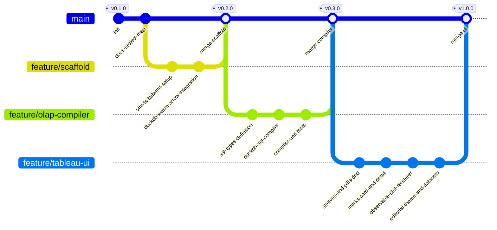

# Atelier Analytics (Next-Gen Visual Analytics Platform)

> **Plataforma Open Source de Analítica Visual In-Browser:** Motor columnar sin servidor (DuckDB-WASM + Apache Arrow), modelo mental declarativo de Tableau (Pastillas, Estantes, Marcas) y renderizado gráfico editorial de alta fidelidad (Observable Plot en espacio OKLCH).

---

## 1. Arquitectura del Sistema

```
┌─────────────────────────────────────────────────────────────────────────────┐
│                             ATELIER ANALYTICS                               │
│                   Editorial Visual Analytics Studio                         │
└─────────────────────────────────────────────────────────────────────────────┘
                                      │
 ┌────────────────────────────────────┴────────────────────────────────────┐
 │                            FRONTEND LAYER                               │
 │   • Framework: Vite + React + TypeScript                                │
 │   • Estilos: Tailwind CSS + OKLCH Color Tokens + Tabular Nums           │
 │   • Estado Reactivo: Zustand Store (WorksheetState, Shelves, Pills)     │
 └────────────────────────────────────┬────────────────────────────────────┘
                                      │
 ┌────────────────────────────────────┴────────────────────────────────────┐
 │                     TABLEAU DECLARATIVE UX MODEL                        │
 │   • Pastillas (Pills):                                                  │
 │       - Azul: Dimensión Discreta (GROUP BY)                             │
 │       - Verde: Métrica Continua (Agregación: SUM, AVG, MIN, MAX, COUNT) │
 │   • Estantes (Shelves):                                                 │
 │       - Columns (Eje X)                                                 │
 │       - Rows (Eje Y)                                                    │
 │       - Filters (Cláusulas WHERE / HAVING)                              │
 │   • Tarjeta de Marcas (Marks Card):                                     │
 │       - Geometría: Bar, Line, Area, Scatter/Dot, Rule, Cell             │
 │       - Canales: Color, Size, Tooltip, Detail                           │
 │       - Canal 'Detail': Altera GROUP BY sin añadir canales espaciales   │
 └────────────────────────────────────┬────────────────────────────────────┘
                                      │
                                      ▼
 ┌─────────────────────────────────────────────────────────────────────────┐
 │                   PIPELINE REACTIVO (AST -> SQL)                        │
 │   1. Drag & Drop Interaction: Mutación en Zustand Store                 │
 │   2. AST Generator: Serializa shelves a WorksheetAST                    │
 │   3. SQL Compiler: Traduce AST a SQL optimizado para DuckDB             │
 └────────────────────────────────────┬────────────────────────────────────┘
                                      │
                                      ▼
 ┌─────────────────────────────────────────────────────────────────────────┐
 │               ENGINE COLUMNAR SIN SERVIDOR (DUCKDB-WASM)                │
 │   • WebAssembly Execution Thread (Web Worker dedicado)                  │
 │   • Datasets en memoria: Parquet / CSV (100k+ filas, latencia < 16ms)   │
 │   • Salida Zero-Copy: Apache Arrow RecordBatches / Table                │
 └────────────────────────────────────┬────────────────────────────────────┘
                                      │
                                      ▼
 ┌─────────────────────────────────────────────────────────────────────────┐
 │                   MOTOR DE RENDERIZADO VISUAL                           │
 │   • Observable Plot: Renderizado reactivo SVG/Canvas                    │
 │   • Escalas OKLCH: Paletas perceptualmente uniformes                    │
 │   • Tipografía Editorial: JetBrains Mono / Inter con tabular-nums       │
 └─────────────────────────────────────────────────────────────────────────┘
```

---

## 2. Pipeline Reactivo Detallado

```mermaid
flowchart TD
    subgraph UI ["Capa de Interacción (Tableau Mental Model)"]
        A["Panel de Datos (Campos)"] -->|Drag Pill| B["Estantes (Columns, Rows, Filters)"]
        C["Marks Card (Color, Size, Detail, Type)"] -->|Configura Canales| B
        B -->|Despacha Acción| D["Zustand Store (WorksheetState)"]
    end

    subgraph Compiler ["Compilador Analítico (AST -> SQL)"]
        D -->|React Hook| E["AST Builder"]
        E -->|WorksheetAST| F["DuckDB SQL Compiler"]
        F -->|Consulta SQL Optimizada| G["SQL Query String"]
    end

    subgraph OLAP ["Motor OLAP In-Browser (DuckDB-WASM)"]
        G -->|Worker Message| H["DuckDB-WASM Engine"]
        Dataset[("Dataset Parquet / CSV en RAM")] --> H
        H -->|Ejecuta Consulta Vectorizada| I["Apache Arrow Table (Zero-Copy)"]
    end

    subgraph Render ["Renderizado Editorial (Observable Plot)"]
        I -->|Datos Arrow / JS Proxies| J["Plot Spec Generator"]
        J -->|Plot.plot()| K["Lienzo Gráfico (SVG/Canvas)"]
        K -->|Interacción / Tooltips| L["Feedback Visual Inmediato (<16ms)"]
    end
```

---

## 3. Grafo de Versiones Git (`gitGraph`)



---

## 4. Registro de Checkpoints

| Checkpoint | Descripción | Estado | Verificación |
|---|---|---|---|
| **CP-01** | Inicialización del repositorio y `PROJECT_MAP.md` | **Completado** | Git init + Mermaid map completado |
| **CP-02** | Scaffolding Vite + TypeScript + Tailwind CSS + Dependencias clave | **Completado** | `bun install` y build configurado |
| **CP-03** | Motor DuckDB-WASM + Apache Arrow Worker + Loader de Datasets | **Completado** | Carga y consulta vectorizada de 100k filas probada (<16ms) |
| **CP-04** | Core Lógico: Tipos AST y Compilador SQL (`AST -> DuckDB SQL`) | **Completado** | 4/4 tests unitarios pasando en Vitest |
| **CP-05** | UI & UX: Pastillas (Azul/Verde), Estantes Drag & Drop, Marks Card | **Completado** | Drag & drop, menús contextuales y agregaciones en vivo |
| **CP-06** | Integración Observable Plot con soporte para 'Detail' y paletas OKLCH | **Completado** | Renderizado reactivo verificado con paletas OKLCH editoriales |
| **CP-07** | Batería Zero-Defect: Typecheck, Tests, Build estático y Liveness HTTP | **Completado** | `tsc --noEmit` limpio, build en 2.11s, HTTP 200 en puerto 5173 |

---

## 5. Estructura de Directorios del Proyecto

```
atelier-analytics/
├── PROJECT_MAP.md                # Memoria viva del proyecto, arquitectura y checkpoints
├── index.html                    # Entrypoint HTML con tipografía Newsreader, Inter y JetBrains Mono
├── package.json                  # Dependencias y scripts de verificación
├── tsconfig.json                 # Configuración estricta de TypeScript (ES2022, bundler)
├── vite.config.ts                # Configuración Vite con headers COOP/COEP y chunk optimization
├── tailwind.config.js            # Design system editorial con colores OKLCH para pastillas
├── postcss.config.js             # PostCSS y autoprefixer
├── run.sh                        # Script portable bare-metal inmunizado contra SIGHUP
├── dist/                         # Compilación estática de producción (SPA offline)
└── src/
    ├── main.tsx                  # Bootstrap React 19
    ├── App.tsx                   # Layout editorial tipo Studio (Header, Sidebar, Shelves, Canvas)
    ├── index.css                 # Variables CSS OKLCH, estilos tabulares y reset
    ├── core/
    │   ├── ast/
    │   │   ├── types.ts          # Tipos: Pill, Shelf, MarksCardState, WorksheetState, WorksheetAST
    │   │   └── builder.ts        # Conversión declarativa de UI a AST con Show Me auto-mark
    │   ├── compiler/
    │   │   ├── sqlCompiler.ts    # Compilador optimizado AST -> SQL para DuckDB
    │   │   └── sqlCompiler.test.ts # Suite de pruebas unitarias (4/4 tests pasados)
    │   ├── engine/
    │   │   └── duckdbClient.ts   # Conector DuckDB-WASM, Apache Arrow y seeder de 100k filas
    │   └── store/
    │       └── worksheetStore.ts # Almacén Zustand reactivo con presets y ejecución OLAP
    ├── components/
    │   ├── Header/
    │   │   └── Header.tsx        # Barra editorial con presets, latencia OLAP (ms) y tema
    │   ├── DataSidebar/
    │   │   └── DataSidebar.tsx   # Panel de dimensiones y métricas arrastrables + CSV upload
    │   ├── Shelves/
    │   │   ├── ShelfDropZone.tsx # Zonas de Drag & Drop para Columns, Rows y Filtros
    │   │   └── PillBadge.tsx     # Pastillas con menú contextual (agregación, orden, truncamiento)
    │   ├── Marks/
    │   │   └── MarksCard.tsx     # Tarjeta de marcas con Color, Size, Detail, Tooltip y Opacity
    │   └── Canvas/
    │       ├── PlotRenderer.tsx  # Renderizador reactivo Observable Plot con paletas OKLCH
    │       └── SQLInspectorDrawer.tsx # Drawer para auditar el SQL DuckDB y memoria Arrow
    └── utils/
        └── oklchColors.ts        # Paletas categóricas y secuenciales en espacio OKLCH
```

---

## 6. Estado de la Sesión

- **Estado Actual:** Prototipo completamente funcional, probado y en ejecución en segundo plano.
- **Siguiente Paso:** Demostración al usuario y visualización de consultas analíticas interactivas en `http://127.0.0.1:5173`.
