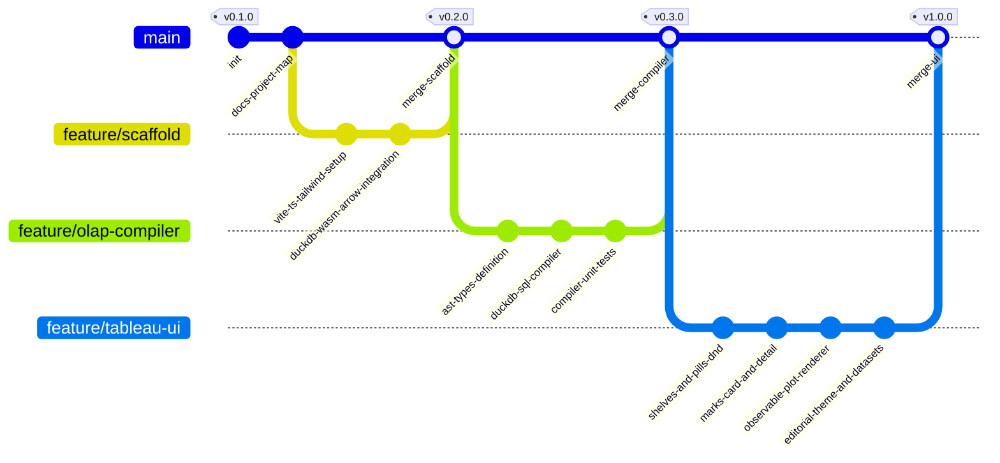

# Atelier Analytics (Next-Gen Visual Analytics Platform)

> **Plataforma Open Source de Analítica Visual In-Browser:** Motor columnar sin servidor (DuckDB-WASM + Apache Arrow), modelo mental declarativo de Tableau (Pastillas, Estantes, Marcas) y renderizado gráfico editorial de alta fidelidad (Observable Plot en espacio OKLCH).

---

## 1. Arquitectura del Sistema

```
┌─────────────────────────────────────────────────────────────────────────────┐
│                             ATELIER ANALYTICS                               │
│                   Editorial Visual Analytics Studio                         │
└─────────────────────────────────────────────────────────────────────────────┘
                                      │
 ┌────────────────────────────────────┴────────────────────────────────────┐
 │                            FRONTEND LAYER                               │
 │   • Framework: Vite + React + TypeScript                                │
 │   • Estilos: Tailwind CSS + OKLCH Color Tokens + Tabular Nums           │
 │   • Estado Reactivo: Zustand Store (WorksheetState, Shelves, Pills)     │
 └────────────────────────────────────┬────────────────────────────────────┘
                                      │
 ┌────────────────────────────────────┴────────────────────────────────────┐
 │                     TABLEAU DECLARATIVE UX MODEL                        │
 │   • Pastillas (Pills):                                                  │
 │       - Azul: Dimensión Discreta (GROUP BY)                             │
 │       - Verde: Métrica Continua (Agregación: SUM, AVG, MIN, MAX, COUNT) │
 │   • Estantes (Shelves):                                                 │
 │       - Columns (Eje X)                                                 │
 │       - Rows (Eje Y)                                                    │
 │       - Filters (Cláusulas WHERE / HAVING)                              │
 │   • Tarjeta de Marcas (Marks Card):                                     │
 │       - Geometría: Bar, Line, Area, Scatter/Dot, Rule, Cell             │
 │       - Canales: Color, Size, Tooltip, Detail                           │
 │       - Canal 'Detail': Altera GROUP BY sin añadir canales espaciales   │
 └────────────────────────────────────┬────────────────────────────────────┘
                                      │
                                      ▼
 ┌─────────────────────────────────────────────────────────────────────────┐
 │                   PIPELINE REACTIVO (AST -> SQL)                        │
 │   1. Drag & Drop Interaction: Mutación en Zustand Store                 │
 │   2. AST Generator: Serializa shelves a WorksheetAST                    │
 │   3. SQL Compiler: Traduce AST a SQL optimizado para DuckDB             │
 └────────────────────────────────────┬────────────────────────────────────┘
                                      │
                                      ▼
 ┌─────────────────────────────────────────────────────────────────────────┐
 │               ENGINE COLUMNAR SIN SERVIDOR (DUCKDB-WASM)                │
 │   • WebAssembly Execution Thread (Web Worker dedicado)                  │
 │   • Datasets en memoria: Parquet / CSV (100k+ filas, latencia < 16ms)   │
 │   • Salida Zero-Copy: Apache Arrow RecordBatches / Table                │
 └────────────────────────────────────┬────────────────────────────────────┘
                                      │
                                      ▼
 ┌─────────────────────────────────────────────────────────────────────────┐
 │                   MOTOR DE RENDERIZADO VISUAL                           │
 │   • Observable Plot: Renderizado reactivo SVG/Canvas                    │
 │   • Escalas OKLCH: Paletas perceptualmente uniformes                    │
 │   • Tipografía Editorial: JetBrains Mono / Inter con tabular-nums       │
 └─────────────────────────────────────────────────────────────────────────┘
```

---

## 2. Pipeline Reactivo Detallado

```mermaid
flowchart TD
    subgraph UI ["Capa de Interacción (Tableau Mental Model)"]
        A["Panel de Datos (Campos)"] -->|Drag Pill| B["Estantes (Columns, Rows, Filters)"]
        C["Marks Card (Color, Size, Detail, Type)"] -->|Configura Canales| B
        B -->|Despacha Acción| D["Zustand Store (WorksheetState)"]
    end

    subgraph Compiler ["Compilador Analítico (AST -> SQL)"]
        D -->|React Hook| E["AST Builder"]
        E -->|WorksheetAST| F["DuckDB SQL Compiler"]
        F -->|Consulta SQL Optimizada| G["SQL Query String"]
    end

    subgraph OLAP ["Motor OLAP In-Browser (DuckDB-WASM)"]
        G -->|Worker Message| H["DuckDB-WASM Engine"]
        Dataset[("Dataset Parquet / CSV en RAM")] --> H
        H -->|Ejecuta Consulta Vectorizada| I["Apache Arrow Table (Zero-Copy)"]
    end

    subgraph Render ["Renderizado Editorial (Observable Plot)"]
        I -->|Datos Arrow / JS Proxies| J["Plot Spec Generator"]
        J -->|Plot.plot()| K["Lienzo Gráfico (SVG/Canvas)"]
        K -->|Interacción / Tooltips| L["Feedback Visual Inmediato (<16ms)"]
    end
```

---

## 3. Grafo de Versiones Git (`gitGraph`)



---

## 4. Registro de Checkpoints

| Checkpoint | Descripción | Estado | Verificación |
|---|---|---|---|
| **CP-01** | Inicialización del repositorio y `PROJECT_MAP.md` | **En progreso** | Git init + Mermaid map completado |
| **CP-02** | Scaffolding Vite + TypeScript + Tailwind CSS + Dependencias clave | Pendiente | `bun run build` exitoso |
| **CP-03** | Motor DuckDB-WASM + Apache Arrow Worker + Loader de Datasets | Pendiente | Carga y consulta de 100k+ filas verificada |
| **CP-04** | Core Lógico: Tipos AST y Compilador SQL (`AST -> DuckDB SQL`) | Pendiente | Tests unitarios del compilador con 100% éxito |
| **CP-05** | UI & UX: Pastillas (Azul/Verde), Estantes Drag & Drop, Marks Card | Pendiente | Interacción drag & drop fluida sin latencia |
| **CP-06** | Integración Observable Plot con soporte para 'Detail' y paletas OKLCH | Pendiente | Renderizado reactivo verificado en todos los tipos de marcas |
| **CP-07** | Batería Zero-Defect: Typecheck, Linter, Build estático, Tests | Pendiente | `tsc`, linter, tests y build sin advertencias |

---

## 5. Estructura de Directorios Propuesta

```
atelier-analytics/
├── PROJECT_MAP.md                # Memoria viva del proyecto y arquitectura
├── index.html                    # Entrypoint HTML con tipografías y viewport
├── package.json                  # Dependencias y scripts
├── tsconfig.json                 # Configuración estricta de TypeScript
├── vite.config.ts                # Configuración Vite (con soporte WASM y Workers)
├── public/
│   ├── datasets/                 # Datasets de muestra (Parquet / CSV de prueba)
│   │   ├── superstore_sales.parquet
│   │   └── global_air_quality.parquet
│   └── duckdb/                   # Binarios y workers de DuckDB-WASM
└── src/
    ├── main.tsx                  # Bootstrap de React
    ├── App.tsx                   # Layout principal de Atelier Studio
    ├── index.css                 # Tokens de diseño editorial (OKLCH, tipografía)
    ├── core/
    │   ├── ast/                  # Definición del Árbol de Sintaxis Abstracta
    │   │   ├── types.ts          # Tipos: Pill, Shelf, MarkChannel, WorksheetAST
    │   │   └── builder.ts        # Conversión WorksheetState -> WorksheetAST
    │   ├── compiler/             # Compilador analítico
    │   │   ├── sqlCompiler.ts    # Generador de SQL optimizado para DuckDB
    │   │   └── sqlCompiler.test.ts # Tests exhaustivos del compilador
    │   ├── engine/               # Conector y runner de DuckDB-WASM
    │   │   ├── duckdbClient.ts   # Inicialización y ejecución sobre DuckDB
    │   │   ├── arrowBridge.ts    # Utilidades para manipulación de Apache Arrow
    │   │   └── sampleData.ts     # Generador/cargador de datasets de prueba
    │   └── store/                # Almacén de estado reactivo
    │       └── worksheetStore.ts # Zustand store para estantes, marcas y filtros
    ├── components/
    │   ├── Header/               # Barra superior editorial (Dataset selector, export)
    │   ├── DataSidebar/          # Lista de campos (Dimensiones y Métricas)
    │   │   ├── FieldItem.tsx     # Pastilla de campo arrastrable
    │   │   └── DataSidebar.tsx   # Panel de dimensiones y métricas
    │   ├── Shelves/              # Estantes interactivos
    │   │   ├── Shelf.tsx         # Zona de drop genérica (Columns, Rows, Filters)
    │   │   └── Pill.tsx          # Pastilla interactiva con menú contextual
    │   ├── Marks/                # Tarjeta de Marcas (Marks Card)
    │   │   ├── MarksCard.tsx     # Selector de tipo de marca y estantes de canal
    │   │   └── MarkShelf.tsx     # Estantes para Color, Size, Detail, Tooltip
    │   ├── Canvas/               # Lienzo de visualización
    │   │   ├── VisualCanvas.tsx  # Wrapper del lienzo con status de consulta
    │   │   ├── PlotView.tsx      # Componente de renderizado Observable Plot
    │   │   └── SQLInspector.tsx  # Drawer editorial para ver el SQL compilado
    │   └── Common/               # Componentes UI reutilizables
    └── utils/
        └── oklchColors.ts        # Generador de paletas OKLCH editoriales
```

---

## 6. Estado de la Sesión

- **Estado Actual:** En progreso (Fase 1 completada, iniciando Scaffolding Fase 2).
- **Siguiente Paso:** Inicializar Vite + React + TypeScript + Tailwind CSS e instalar dependencias `@duckdb/duckdb-wasm`, `apache-arrow`, `@observablehq/plot`, `zustand`, `lucide-react`.
