# Atelier Analytics (Next-Gen Visual Analytics Platform)

> **Plataforma Open Source de Analítica Visual In-Browser:** Motor columnar sin servidor (DuckDB-WASM + Apache Arrow), modelo mental declarativo de Tableau (Pastillas, Estantes, Marcas) y renderizado gráfico editorial de alta fidelidad (Observable Plot en espacio OKLCH).

---

## 1. Arquitectura del Sistema

```
┌─────────────────────────────────────────────────────────────────────────────┐
│                             ATELIER ANALYTICS                               │
│                   Editorial Visual Analytics Studio                         │
└─────────────────────────────────────────────────────────────────────────────┘
                                      │
 ┌────────────────────────────────────┴────────────────────────────────────┐
 │                            FRONTEND LAYER                               │
 │   • Framework: Vite + React + TypeScript                                │
 │   • Estilos: Tailwind CSS + OKLCH Color Tokens + Tabular Nums           │
 │   • Estado Reactivo: Zustand Store (WorksheetState, Shelves, Pills)     │
 └────────────────────────────────────┬────────────────────────────────────┘
                                      │
 ┌────────────────────────────────────┴────────────────────────────────────┐
 │                     TABLEAU DECLARATIVE UX MODEL                        │
 │   • Pastillas (Pills):                                                  │
 │       - Azul: Dimensión Discreta (GROUP BY)                             │
 │       - Verde: Métrica Continua (Agregación: SUM, AVG, MIN, MAX, COUNT) │
 │   • Estantes (Shelves):                                                 │
 │       - Columns (Eje X)                                                 │
 │       - Rows (Eje Y)                                                    │
 │       - Filters (Cláusulas WHERE / HAVING)                              │
 │   • Tarjeta de Marcas (Marks Card):                                     │
 │       - Geometría: Bar, Line, Area, Scatter/Dot, Rule, Cell             │
 │       - Canales: Color, Size, Tooltip, Detail                           │
 │       - Canal 'Detail': Altera GROUP BY sin añadir canales espaciales   │
 └────────────────────────────────────┬────────────────────────────────────┘
                                      │
                                      ▼
 ┌─────────────────────────────────────────────────────────────────────────┐
 │                   PIPELINE REACTIVO (AST -> SQL)                        │
 │   1. Drag & Drop Interaction: Mutación en Zustand Store                 │
 │   2. AST Generator: Serializa shelves a WorksheetAST                    │
 │   3. SQL Compiler: Traduce AST a SQL optimizado para DuckDB             │
 └────────────────────────────────────┬────────────────────────────────────┘
                                      │
                                      ▼
 ┌─────────────────────────────────────────────────────────────────────────┐
 │               ENGINE COLUMNAR SIN SERVIDOR (DUCKDB-WASM)                │
 │   • WebAssembly Execution Thread (Web Worker dedicado)                  │
 │   • Datasets en memoria: Parquet / CSV (100k+ filas, latencia < 16ms)   │
 │   • Salida Zero-Copy: Apache Arrow RecordBatches / Table                │
 └────────────────────────────────────┬────────────────────────────────────┘
                                      │
                                      ▼
 ┌─────────────────────────────────────────────────────────────────────────┐
 │                   MOTOR DE RENDERIZADO VISUAL                           │
 │   • Observable Plot: Renderizado reactivo SVG/Canvas                    │
 │   • Escalas OKLCH: Paletas perceptualmente uniformes                    │
 │   • Tipografía Editorial: JetBrains Mono / Inter con tabular-nums       │
 └─────────────────────────────────────────────────────────────────────────┘
```

---

## 2. Pipeline Reactivo Detallado

```mermaid
flowchart TD
    subgraph UI ["Capa de Interacción (Tableau Mental Model)"]
        A["Panel de Datos (Campos)"] -->|Drag Pill| B["Estantes (Columns, Rows, Filters)"]
        C["Marks Card (Color, Size, Detail, Type)"] -->|Configura Canales| B
        B -->|Despacha Acción| D["Zustand Store (WorksheetState)"]
    end

    subgraph Compiler ["Compilador Analítico (AST -> SQL)"]
        D -->|React Hook| E["AST Builder"]
        E -->|WorksheetAST| F["DuckDB SQL Compiler"]
        F -->|Consulta SQL Optimizada| G["SQL Query String"]
    end

    subgraph OLAP ["Motor OLAP In-Browser (DuckDB-WASM)"]
        G -->|Worker Message| H["DuckDB-WASM Engine"]
        Dataset[("Dataset Parquet / CSV en RAM")] --> H
        H -->|Ejecuta Consulta Vectorizada| I["Apache Arrow Table (Zero-Copy)"]
    end

    subgraph Render ["Renderizado Editorial (Observable Plot)"]
        I -->|Datos Arrow / JS Proxies| J["Plot Spec Generator"]
        J -->|Plot.plot()| K["Lienzo Gráfico (SVG/Canvas)"]
        K -->|Interacción / Tooltips| L["Feedback Visual Inmediato (<16ms)"]
    end
```

---

## 3. Grafo de Versiones Git (`gitGraph`)

```mermaid
gitGraph
    commit id: "init" tag: "v0.1.0"
    commit id: "docs-project-map"
    branch feature/scaffold
    checkout feature/scaffold
    commit id: "vite-ts-tailwind-setup"
    commit id: "duckdb-wasm-arrow-integration"
    checkout main
    merge feature/scaffold id: "merge-scaffold" tag: "v0.2.0"
    branch feature/olap-compiler
    checkout feature/olap-compiler
    commit id: "ast-types-definition"
    commit id: "duckdb-sql-compiler"
    commit id: "compiler-unit-tests"
    checkout main
    merge feature/olap-compiler id: "merge-compiler" tag: "v0.3.0"
    branch feature/tableau-ui
    checkout feature/tableau-ui
    commit id: "shelves-and-pills-dnd"
    commit id: "marks-card-and-detail"
    commit id: "observable-plot-renderer"
    commit id: "editorial-theme-and-datasets"
    checkout main
    merge feature/tableau-ui id: "merge-ui" tag: "v1.0.0"
    commit id: "interactive-filters" tag: "v1.1.0"
    commit id: "workbooks-dashboards-calc-params" tag: "v1.2.0"
    commit id: "auto-role-duckdb-functions" tag: "v1.3.0"
    commit id: "tableau-parameter-dialog-controls" tag: "v1.4.0"
    commit id: "dashboard-filters-and-scoping" tag: "v1.5.0"
    commit id: "tableau-desktop-full-power" tag: "v1.6.0"
    commit id: "observable-plot-expanded-catalog" tag: "v1.7.0"
    commit id: "cross-tab-and-multi-measure-clustered-charts" tag: "v1.8.0"
    commit id: "fix-text-table-hooks-and-error-boundary" tag: "v1.8.1"
    commit id: "indexeddb-persistence-and-session-autosave" tag: "v1.9.0"
    commit id: "multi-source-and-visual-data-modeling" tag: "v2.0.0"
    commit id: "storage-transparency-and-multi-workbook-catalog" tag: "v2.1.0"
    commit id: "mac-desktop-launcher-path-fix" tag: "v2.1.1"
    commit id: "tableau-start-page-and-recent-workbooks" tag: "v2.2.0"
    commit id: "excel-xlsx-xls-sheetjs-multi-sheet" tag: "v2.3.0"
    commit id: "data-interpreter-source-filters-and-prep" tag: "v2.4.0"
    commit id: "fix-data-type-casting-and-sidebar-popover" tag: "v2.4.1"
    commit id: "tableau-splits-trim-and-bidirectional-casts" tag: "v2.5.0"
    commit id: "sqlite-tableau-packaged-and-relational-db-connectors" tag: "v2.6.0"
    commit id: "tableau-lod-expressions" tag: "v2.7.0"
    commit id: "hierarchies-and-dynamic-drill" tag: "v2.8.0"
    commit id: "number-formatting-engine" tag: "v2.9.0"
    commit id: "executive-export-and-bundle-optimization" tag: "v3.0.0"
    commit id: "unslop-precision-swiss-density" tag: "v3.1.0"
    commit id: "tableau-formula-normalization-marks-compact-and-type-casting" tag: "v3.2.0"
```



---

## 4. Registro de Checkpoints

| Checkpoint | Descripción | Estado | Verificación |
|---|---|---|---|
| **CP-01** | Inicialización del repositorio y `PROJECT_MAP.md` | **Completado** | Git init + Mermaid map completado |
| **CP-02** | Scaffolding Vite + TypeScript + Tailwind CSS + Dependencias clave | **Completado** | `bun install` y build configurado |
| **CP-03** | Motor DuckDB-WASM + Apache Arrow Worker + Loader de Datasets | **Completado** | Carga y consulta vectorizada de 100k filas probada (<16ms) |
| **CP-04** | Core Lógico: Tipos AST y Compilador SQL (`AST -> DuckDB SQL`) | **Completado** | 4/4 tests unitarios pasando en Vitest |
| **CP-05** | UI & UX: Pastillas (Azul/Verde), Estantes Drag & Drop, Marks Card | **Completado** | Drag & drop, menús contextuales y agregaciones en vivo |
| **CP-06** | Integración Observable Plot con soporte para 'Detail' y paletas OKLCH | **Completado** | Renderizado reactivo verificado con paletas OKLCH editoriales |
| **CP-07** | Batería Zero-Defect: Typecheck, Tests, Build estático y Liveness HTTP | **Completado** | `tsc --noEmit` limpio, build en 2.11s, HTTP 200 en puerto 5173 |
| **CP-08** | Sistema Interactivo de Filtros: Shelf drag-and-drop, Modal categórico y numérico | **Completado** | `FilterShelf` y `FilterModal` integrados con consultas DuckDB para valores únicos y rangos |
| **CP-09** | Modelo Workbook Completo: Multi-Tabs, Dashboards Compuestos, Campos Calculados y Parámetros | **Completado** | Pestañas inferiores Tableau, `DashboardGrid` multi-visual, persistencia `.atelier`/localStorage, editor de cálculos y parámetros |
| **CP-10** | Inferencia Automática (Tableau-Style) y Superpoderes Vectoriales | **Completado** | Detección automática en vivo del rol analítico (Métrica verde vs Dimensión azul) y tipo de dato mediante `typeof()` en DuckDB-WASM, con toggle de anulación manual opcional. Soporte de funciones avanzadas (Pearson `CORR`, Regresión `REGR_SLOPE`/`REGR_R2`, Percentiles exactos `QUANTILE_CONT`, HLL, Regex PCRE y JSON). |
| **CP-11** | Parámetros Auténticos Estilo Tableau Desktop | **Completado** | Diálogo completo "Crear Parámetro": Tipos de datos (Float, Int, String, Boolean, Date), Formato de visualización, Valores permisibles (Todos, Lista, Rango), importación con 1 clic ("Añadir valores desde campo..." y "Establecer rango desde campo..."), tokens con espacios `[Top N]` y barra interactiva de controles en lienzo (`ParameterControlsBar.tsx`). |
| **CP-12** | Filtros y Parámetros en Dashboards con Scoping "Aplicar a hojas de trabajo..." | **Completado** | Adición y edición de filtros directamente en Dashboards (`+ Añadir Filtro`). Menú de alcance de impacto idéntico a Tableau Desktop (*"Todas las hojas del dashboard"* vs *"Hojas seleccionadas..."* con checklist). Bucle de ejecución DuckDB-WASM aislado por visual, indicadores visuales de impacto en cada tarjeta y 7/7 tests unitarios pasando. |
| **CP-13** | Experiencia Tableau Desktop Completa: Cálculos Rápidos (`Δ`), Analytics Pane, Filtro Cruzado y Show Me | **Completado** | Implementación de las 5 capacidades maestras de Tableau: 1) Cálculos de tabla rápidos con funciones de ventana DuckDB (% del Total, Total Acumulado, Diferencia, % Diferencia, Rango, Media móvil) con distintivo dorado `Δ`; 2) Pestaña 'Análisis' en la barra lateral con Líneas de Promedio, Mediana y Tendencia en Observable Plot; 3) Acciones de Dashboard / Filtro Cruzado ("Usar como filtro") con chips interactivos y banner de filtro; 4) Panel inteligente *Show Me* con evaluación de requisitos dimensionales/métricos y cambio en 1 clic; 5) Botón Swap para intercambio instantáneo de estantes Rows & Columns. Batería Zero-Defect (8/8 tests, 0 errores tsc, build limpio). |
| **CP-14** | Desbloqueo del Catálogo Completo de Observable Plot (15 Arquetipos Analíticos) | **Completado** | Integración nativa de la gramática visual avanzada de Observable Plot: Boxplot (`Plot.boxY`/`boxX`), Histograma continuo (`Plot.rectY` con `Plot.binX`), Densidad 2D / Contornos (`Plot.density`), Hexbin (`Plot.hexagon`/`hexbin`), Gráfico de Picos (`Plot.spike`), Gráfico de Diferencia (`Plot.differenceY`), Waffle de unidades (`Plot.waffleY`), y Tabla de Texto. Consultas unaggregated en DuckDB para distribuciones estadísticas, inferencia automática ampliada y galería Show Me con 15 arquetipos. Batería Zero-Defect (9/9 tests, 0 errores tsc, build limpio). |
| **CP-15** | Tabla de Texto Auténtica (Cross-Tab) y Gráficos Multimétrica Agrupados (Clustered Charts) | **Completado** | 1) `TextTableRenderer.tsx` interactivo con ordenación por columnas, búsqueda en vivo, fila de Total General (`tfoot`), indicadores de rol de pastilla (azul/verde), copia a TSV para Excel/Sheets y exportación a CSV; 2) Soporte multimétrica completo en `PlotRenderer.tsx` para barras agrupadas verticales y horizontales (`isMultiMeasureVertical` y `isMultiMeasureHorizontal` con faceteado `fx`/`fy`), líneas multi-métrica y áreas continuas desnormalizadas en tiempo de renderizado con leyenda automática OKLCH; 3) 11/11 tests unitarios pasando, 0 errores tsc, build limpio y liveness HTTP 200 en puerto 5173. |
| **CP-16** | Corrección de React Hooks en Tabla de Texto y Canvas Error Boundary | **Completado** | 1) Corrección de orden de React Hooks en `PlotRenderer.tsx`: eliminado retorno anticipado condicional antes de hooks (`Rendered fewer hooks than expected`) y movido al retorno JSX final; 2) Creado `CanvasErrorBoundary.tsx` para aislar cualquier excepción de renderizado y prevenir pantallas en blanco; 3) Blindado `TextTableRenderer.tsx` con soporte para BigInt, descubrimiento universal de pastillas y portapapeles seguro; 4) 13/13 tests pasando en Vitest (con suite para TextTableRenderer), 0 errores `tsc`, build en 2.36s y HTTP 200 en http://127.0.0.1:5173. |
| **CP-17** | Persistencia Completa In-Browser: IndexedDB Datasets, Auto-Save Reactivo y Protección BeforeUnload | **Completado** | 1) Almacenamiento binario del dataset (`File`/`Blob`) en IndexedDB para supervivencia a recargas y F5; 2) Auto-guardado en segundo plano con debounce (250ms) del AST, estantes, hojas, campos calculados y parámetros; 3) Rehidratación automática transparente en `initEngine` montando el dataset en DuckDB-WASM y re-ejecutando queries; 4) Protección nativa `beforeunload` para advertir antes de recargas accidentales; 5) Badge visual "Auto-guardado activo" en Header; 6) 15/15 tests pasando en Vitest, 0 errores tsc, build limpio y HTTP 200 en puerto 5173. |
| **CP-18** | Multi-Fuente y Modelado Relacional de Datos: Joins, Unions y Dashboards Compuestos | **Completado** | 1) Soporte multi-tabla simultáneo en DuckDB-WASM (cada archivo se monta como tabla independiente); 2) Selector multi-fuente en la barra lateral con botón `+ Fuente` y badge de tablas cargadas; 3) Vinculación por hoja (`sheet.tableName`/`sheet.datasetId`), permitiendo que cada hoja analice un archivo diferente y convivan en el mismo Dashboard con badge de origen; 4) Asistente visual de modelado de datos (`DataModelModal.tsx`) con soporte para 4 tipos de JOIN (`LEFT`, `INNER`, `FULL`, `RIGHT`), desambiguación automática de nombres de columnas y apilado vertical `UNION ALL BY NAME`; 5) Previsualización en vivo en 5 filas con DuckDB-WASM; 6) 18/18 tests unitarios pasando, 0 errores tsc, build limpio en 2.40s y HTTP 200 en puerto 5173. |
| **CP-19** | Transparencia de Almacenamiento Local y Catálogo de Reportes Múltiples | **Completado** | 1) Modal de Transparencia de Almacenamiento (`StorageInspectorModal.tsx`) accesible al pulsar el badge "Guardado en Mac" en el Header; muestra métricas de almacenamiento, arquitectura en capas, ubicación física en disco en macOS (`~/Library/Application Support/...`) y botón para exportar `.atelier` a `~/Downloads`; 2) Catálogo de Reportes Múltiples en el Header con selector de reporte activo, renombrado en tiempo real, creación de nuevos reportes independientes (`+ Nuevo Reporte en Blanco`) sin cerrar ni perder el trabajo activo y alternancia instantánea en 1 clic; 3) 19/19 tests unitarios pasando en Vitest, 0 errores de TypeScript, compilación de producción en 2.58s y HTTP 200 en http://127.0.0.1:5173. |
| **CP-20** | Resolución de PATH en Launcher de Escritorio y Acceso Directo macOS | **Completado** | 1) Corrección de error `nohup: bun: No such file or directory` al abrir desde `Atelier Analytics.app` o `.command`; 2) Exportación explícita de `PATH` (`$HOME/.bun/bin:/opt/homebrew/bin:/usr/local/bin:$PATH`) en `run.sh`, `launch-desktop.sh` y `main.scpt`; 3) Resolución dinámica y portable de rutas sin hardcoding de `/Users/joe`; 4) Verificación empírica mediante `open` en macOS con inicio de servidor en 187ms y respuesta HTTP 200. |
| **CP-21** | Página de Inicio Auténtica de Tableau Desktop (`StartPage.tsx`) con Libros Recientes y Muestras | **Completado** | 1) Pantalla de inicio Tableau Desktop (`StartPage.tsx`) activa al arrancar la app; 2) Panel izquierdo "Conectar": Excel, CSV, Parquet, JSON y fuentes de muestra con 1 clic (Superstore Sales y World Indicators); 3) Panel central "Libros de trabajo recientes": tarjetas con vista previa gráfica, fechas relativas, estado activo y banner de reanudación inmediata; 4) Toggle bidireccional mediante el logo de Atelier en el Header para alternar entre el Inicio y el Lienzo sin cerrar nada; 5) 19/19 tests unitarios pasando, 0 errores tsc, build limpio y HTTP 200 en http://127.0.0.1:5173. |
| **CP-22** | Soporte Nativo de Archivos Microsoft Excel (.xlsx / .xls) Multi-Hoja con SheetJS y DuckDB-WASM | **Completado** | 1) Ingestión client-side de archivos Excel (.xlsx y .xls) mediante SheetJS (`xlsx@0.18.5`); 2) Preservación de precisión numérica con `rawNumbers: true` para evitar distorsiones por formatos de moneda o porcentajes; 3) Soporte multi-hoja completo estilo Tableau Desktop: cada hoja se carga como una tabla independiente en DuckDB y se registra en `availableDatasets`, permitiendo análisis directo y relaciones (JOIN/UNION); 4) Conector independiente "Microsoft Excel" en StartPage, EmptyWorkspace y barra lateral; 5) 23/23 tests pasando en Vitest, 0 errores tsc, build limpio y HTTP 200. |
| **CP-23** | Tableau Data Interpreter, Filtros de Fuente de Datos y Prelimpieza de Datos en Cuadrícula | **Completado** | 1) Data Interpreter (`dataInterpreter.ts`) con heurística de encabezados, detección de notas, metadatos y poda de subtotales/totales generales al pie; 2) Arquitectura física base + vista SQL en DuckDB (`CREATE OR REPLACE VIEW ... WHERE ...`) para Filtros de Fuente de Datos que gobiernan a nivel raíz antes de hojas y dashboards; 3) Prelimpieza de datos en cuadrícula (renombrado, TRY_CAST vectorial con EXCLUDE, SPLIT_PART por delimitador, TRIM/UPPER/LOWER y ocultamiento de campos); 4) Pestaña "Fuente de datos" en TabBar y banco de trabajo `DataSourceWorkbench.tsx`; 5) 29/29 tests unitarios pasando, 0 errores tsc, build limpio y HTTP 200. |
| **CP-24** | Robustecimiento del Cambio de Tipos de Datos (Cast) y Popover Interactivo en Panel Lateral | **Completado** | 1) Auto-sanación en `castColumn`: verificación y creación dinámica de la tabla física base `_base` si no existe; 2) Expresiones SQL multi-formato con `COALESCE` para números (limpieza de `$`, `€`, comas de miles y espacios), fechas (`%Y-%m-%d`, `%d/%m/%Y`, `%m/%d/%Y`, etc.) y booleanos (reconociendo 'si', 'sí', 'verdadero', 'false', '0', etc.); 3) Preservación estricta del orden original de columnas en DuckDB y preservación del flag `hidden`; 4) Sincronización automática de pastillas en todas las hojas (`pills`) al cambiar tipos o roles para evitar fallos de ejecución; 5) Popover interactivo estilo Tableau Desktop en el panel lateral (`DataSidebar.tsx`): clic en el icono (`#`, `Abc`, `📅`, `T/F`) o clic derecho para cambiar tipo, convertir dimensión/medida u ocultar; 6) 31/31 tests pasando en Vitest, 0 errores tsc, build limpio y HTTP 200. |
| **CP-25** | Emulación Tableau Desktop: División de Columnas (Split / Custom Split), Limpieza de Texto (TRIM / Case) y Conversión Bidireccional de Tipos | **Completado** | 1) Helper universal `ensureBaseTable` para auto-sanación de tablas físicas `_base` en todas las operaciones de preparación (rename, cast, split, clean); 2) División de columnas (`splitColumn`) con convención Tableau `[Field] - Split 1..N` deduplicada contra colisiones de catálogo y soporte de modos First N, Last N (indexación negativa DuckDB) y All (cálculo de tokens máximos); 3) Modal interactivo dedicado para División Personalizada en `DataSourceWorkbench.tsx` (delimitador, selector First/Last/All y N columnas); 4) Limpieza de texto (`cleanColumn`) blindada con `CAST(... AS VARCHAR)` para evitar excepciones de binder en columnas numéricas o fechas; 5) Conversiones bidireccionales completas de tipos (número ⇄ cadena sin trailing `.0` en enteros, string ⇄ número con monedas/porcentajes/contabilidad, número ⇄ fecha con años 4 dígitos y días seriales de Excel, fecha ⇄ número con año/epoch); 6) Menú de campo en `DataSidebar.tsx` con acceso rápido a división y trim; 7) 34/34 tests unitarios pasando, 0 errores tsc, build limpio y HTTP 200. |
| **CP-26** | Soporte Nativo de Bases SQLite, Archivos Tableau (.twbx/.tdsx/.twb/.tds) y Servidores Relacionales (PostgreSQL / MySQL) | **Completado** | 1) Ingesta SQLite (`sqliteIngestion.ts`) mediante `sql.js` (WebAssembly) con introspección automática de tablas de usuario y serialización RFC 4180; 2) Ingesta Tableau Desktop (`tableauIngestion.ts`) para descompresión de `.twbx` y `.tdsx` con `JSZip`, parsing XML de `.twb` y extracción de campos calculados y fórmulas; 3) Conector y puente backend local (`relationalDbBridge.ts` + `relationalDbClient.ts`) con drivers `pg` y `mysql2` para prueba de conexión e importación directa a DuckDB-WASM; 4) Modal de conexión a servidor estilo Tableau Desktop (`RelationalDbModal.tsx`) con pestañas PostgreSQL/MySQL, credenciales, selector de tablas o SQL personalizado; 5) Conectores integrados en StartPage, EmptyWorkspace y DataSidebar; 6) 39/39 tests unitarios pasando, 0 errores tsc, build limpio en 3.3s y HTTP 200 OK. |
| **CP-27** | Motor de Expresiones LOD de Tableau (`FIXED`, `INCLUDE`, `EXCLUDE`) con Compilador Correlacionado Vectorial | **Completado** | 1) Parser y compilador LOD (`compileLodExpressions`) en `sqlCompiler.ts`: `{FIXED [Dim] : AGG([Field])}`, `{FIXED : AGG([Field])}` (table-scoped), `{EXCLUDE ...}` e `{INCLUDE ...}`; 2) Generación de subconsultas correlacionadas ultra-rápidas en DuckDB-WASM decorrelacionadas nativamente; 3) Detección de expresiones agregadas Tableau `AGG(...)` evitando anidamientos erróneos de agregación; 4) Biblioteca de funciones y recetas LOD integradas en `CalculatedFieldModal.tsx`; 5) 3/3 tests unitarios dedicados de compilación LOD en `sqlCompiler.test.ts`. |
| **CP-28** | Jerarquías y Drill-down / Drill-up Dinámico (`+` / `-`) en Pastillas y Panel Lateral | **Completado** | 1) Desglose temporal Tableau: `year ➔ quarter ➔ month ➔ week ➔ day`; 2) Botones interactivos `[+]` y `[-]` en `PillBadge.tsx` que expanden y colapsan granularidad en vivo en Rows y Columns sin rehacer el lienzo; 3) Soporte para jerarquías dimensionales personalizadas (`hierarchies` en `DatasetMeta`); 4) Acciones `drillDownPill`, `drillUpPill` y `createHierarchy` en `worksheetStore.ts`; 5) 4/4 tests en `evolutionaryStore.test.ts`. |
| **CP-29** | Motor Universal de Formato Numérico y Tipográfico por Métrica | **Completado** | 1) Utilidad universal `numberFormatter.ts` con soporte para Moneda (`$`, `€`, `£`, etc.), Porcentajes (`%`), Compacto (`K`, `M`, `B`), Notación Científica y Estándar con decimales y comas de miles; 2) Menú contextual en pastillas verdes de métrica (*"Formato de Número..."*) con badges visuales de formato; 3) Propagación reactiva a ejes X/Y de Observable Plot en `PlotRenderer.tsx`, tooltips nativos y celdas y fila de Total General en `TextTableRenderer.tsx`; 4) 6/6 tests unitarios en `numberFormatter.test.ts`. |
| **CP-30** | Suite de Exportación Ejecutiva (PNG Retina, SVG, PDF) y Optimización Arquitectónica de Bundle | **Completado** | 1) Exportador visual `exportVisual.ts`: PNG Retina de alta resolución (escala 2x en Canvas con fondo adaptativo), Vectorial SVG puro con namespaces XML y PDF / Informe Impreso (`window.print()`); 2) Reglas `@media print` en `index.css` que ocultan chrome de UI (toolbars, estantes, sidebars) y renderizan reportes ejecutivos limpios; 3) Dropdown "Exportar" en `Header.tsx`; 4) Optimización de empaquetado en `vite.config.ts` (`manualChunks` dividiendo `vendor-duckdb`, `vendor-sheetjs`, `vendor-sqljs`, `vendor-plot`, `vendor-react-core`, `vendor-lucide`), eliminando advertencias de tamaño y reduciendo el chunk principal de 1,582 kB a 445 kB. |
| **CP-31** | Rediseño Técnico Unslop (Linear-Grade & Precisión Suiza) | **Completado** | Erradicación total de patrones de vibecoding e IA genérica ('AI slop'): 1) Eliminación de cajas de iconos pastel arcoíris y sustitución por filas monocromas de alta densidad con extensiones mono (.xlsx, .csv, .parquet, .sqlite); 2) Sustitución de `font-editorial` y `animate-pulse` por títulos en sans de precisión técnica, estado de memoria estático y sparklines mono; 3) Conversión del panel de marketing 'Descubrir' en Inspector de Telemetría y Diagnóstico (DuckDB WASM, ARM64 SIMD, OPFS) y matriz de atajos `<kbd>`; 4) Adopción de tokens de bisel subpíxel `.rim-light`, respuestas táctiles mecánicas `.btn-tactile` y blueprint `.bg-dot-grid`; 5) Pastillas cartridge estilo Tableau con controles micro `[+]` y `[-]`; 6) Segmented controls en DataSidebar y TabBar compacto de 36px. Batería Zero-Defect: 52/52 tests, 0 errores tsc, build limpio en 3.17s y HTTP 200 en puerto 5173. |
| **CP-32** | Fórmulas Tableau Intuitivas, Canal de Tamaño, Marcas Compactas y Conversión Fluida de Tipos | **Completado** | 1) Normalizador de fórmulas Tableau (`normalizeTableauFormula`): soporte nativo de sintaxis corchetes `[Campo]` ➔ `"Campo"`, sentencias `IF..THEN..ELSEIF..ELSE..END` ➔ `CASE WHEN`, `IIF`, `ZN` y `ISNULL`; 2) Barra táctil de operadores matemáticos/lógicos y dropdowns de inserción de campo/parámetro en `CalculatedFieldModal.tsx` con preview en vivo de fila 1 evaluada por DuckDB; 3) Activación del canal de Tamaño (`Size`): escala `r: sqrt [3, 24]`, auto-inferencia a gráfico de burbujas (`dot`), escalado de puntos en líneas y marcadores lollipop en barras; 4) Rediseño de la tarjeta de Marcas (`MarksCard.tsx`): reemplazo de la cuadrícula estrecha de 2 columnas por filas dedicadas de ancho completo, pastillas compactas que nunca desbordan y botón explícito "Quitar" tanto en la pastilla como en la cabecera del canal; 5) Micro-badge de tipo de datos en `DataSidebar.tsx` con indicador interactivo y caret `▾`, menú contextual mejorado con secciones claras de Tipo de Dato y Rol Analítico, y conversión de tipo/rol directamente desde las pastillas en estantes. Batería Zero-Defect: 53/53 tests unitarios, 0 errores `tsc -b`, build en 3.22s y HTTP 200 en puerto 5173. |

---

## 5. Estructura de Directorios del Proyecto

```
atelier-analytics/
├── PROJECT_MAP.md                # Memoria viva del proyecto, arquitectura y checkpoints
├── index.html                    # Entrypoint HTML con tipografía Newsreader, Inter y JetBrains Mono
├── package.json                  # Dependencias y scripts de verificación
├── tsconfig.json                 # Configuración estricta de TypeScript (ES2022, bundler)
├── vite.config.ts                # Configuración Vite con headers COOP/COEP y chunk optimization
├── tailwind.config.js            # Design system editorial con colores OKLCH para pastillas
├── postcss.config.js             # PostCSS y autoprefixer
├── run.sh                        # Script portable bare-metal con PATH explícito y detección dinámica de bun
├── launch-desktop.sh             # Script lanzador con verificación de socket, PATH explícito y apertura en navegador
├── dist/                         # Compilación estática de producción (SPA offline)
└── src/
    ├── main.tsx                  # Bootstrap React 19
    ├── App.tsx                   # Layout editorial tipo Studio con StorageInspectorModal, DataModelModal, CanvasErrorBoundary
    ├── index.css                 # Variables CSS OKLCH, estilos tabulares y reset
    ├── core/
    │   ├── ast/
    │   │   ├── types.ts          # Tipos: Pill, MarkType, JoinRelationConfig, UnionConfig, WorksheetTab multi-dataset
    │   │   └── builder.ts        # Conversión declarativa de UI a AST con heurística de inferencia
    │   ├── compiler/
    │   │   ├── sqlCompiler.ts    # Compilador optimizado AST -> SQL con soporte para distribution queries y window functions
    │   │   └── sqlCompiler.test.ts # Suite de pruebas unitarias (11/11 tests pasados, 100% verde)
    │   ├── engine/
    │   │   ├── duckdbClient.ts   # Conector DuckDB-WASM con vistas relacionales, tablas base + vistas de filtros de fuente y transformaciones
    │   │   ├── sqliteIngestion.ts # Ingesta SQLite client-side con sql.js WASM e introspección de tablas
    │   │   ├── sqliteIngestion.test.ts # Suite de pruebas unitarias de SQLite (3/3 pasados)
    │   │   ├── tableauIngestion.ts # Extractor de libros Tableau (.twbx/.tdsx/.twb) con JSZip, parsing XML y fórmulas calculadas
    │   │   ├── tableauIngestion.test.ts # Suite de pruebas de libros Tableau (2/2 pasados)
    │   │   ├── relationalDbClient.ts # Cliente frontend para puente relacional y serialización CSV
    │   │   ├── dataInterpreter.ts # Motor Tableau Data Interpreter: detección de cabeceras, notas, metadatos y poda de subtotales
    │   │   ├── dataInterpreter.test.ts # Suite de pruebas del Data Interpreter (3/3 pasados)
    │   │   ├── dataModeling.test.ts # Suite de pruebas unitarias de modelado relacional (3/3 pasados)
    │   │   └── dataPrep.test.ts  # Suite de pruebas unitarias de compilación de filtros de fuente de datos (3/3 pasados)
    │   ├── storage/
    │   │   ├── indexedDBStorage.ts # Motor de persistencia binaria IndexedDB con almacenamiento de datasets, catálogo de workbooks y métricas de disco
    │   │   └── indexedDBStorage.test.ts # Pruebas unitarias de serialización, recuperación de sesiones y catálogo de workbooks (3/3 pasados)
    │   └── store/
    │       └── worksheetStore.ts # Almacén Zustand reactivo con catálogo de reportes y acciones de preparación de datos
    ├── server/
    │   └── relationalDbBridge.ts # Middleware de servidor local Vite para probar y transmitir consultas a PostgreSQL y MySQL
    ├── components/
    │   ├── Header/
    │   │   └── Header.tsx        # Barra editorial con selector de reportes, renombrado en vivo, badge interactivo "Guardado en Mac" y tema
    │   ├── Storage/
    │   │   └── StorageInspectorModal.tsx # Modal de transparencia de almacenamiento local en macOS, métricas de uso y descarga de proyecto
    │   ├── RelationalDb/
    │   │   └── RelationalDbModal.tsx # Diálogo de conexión a servidores relacionales estilo Tableau Desktop (PostgreSQL / MySQL)
    │   ├── DataSidebar/
    │   │   └── DataSidebar.tsx   # Panel Tableau con selector de fuente activa, botón '+ Fuente', botón 'Preparar', botón 'Modelar' y filtro de campos ocultos
    │   ├── DataSource/
    │   │   └── DataSourceWorkbench.tsx # Banco de trabajo Tableau Data Source: toggle Data Interpreter, filtros de fuente y cuadrícula de preparación
    │   ├── DataModel/
    │   │   └── DataModelModal.tsx # Asistente visual de modelado de datos: Relaciones (JOIN), Apilado (UNION) y previsualización interactiva
    │   ├── Tabs/
    │   │   └── TabBar.tsx        # Barra inferior de pestañas con botón "Fuente de datos", cambio de hoja, duplicar y añadir hojas/dashboards
    │   ├── ShowMe/
    │   │   └── ShowMeDrawer.tsx  # Galería inteligente Show Me (15 arquetipos visuales, evaluación de requisitos y recomendados)
    │   ├── Dashboard/
    │   │   └── DashboardGrid.tsx # Lienzo de Dashboard multi-fuente con badge de tabla de origen por tarjeta, filtros y parámetros
    │   │   └── TargetSheetsModal.tsx # Modal Tableau "Aplicar a hojas de trabajo..."
    │   ├── CalculatedFields/
    │   │   └── CalculatedFieldModal.tsx # Editor de fórmulas con biblioteca de funciones y recetas analíticas
    │   ├── Parameters/
    │   │   ├── ParameterModal.tsx # Diálogo completo Tableau: Todos, Lista, Rango, Añadir desde campo y Formato
    │   │   └── ParameterControlsBar.tsx # Barra de controles interactivos en el lienzo
    │   ├── Shelves/
    │   │   ├── ShelfDropZone.tsx # Zonas de Drag & Drop para Columns y Rows con botón Swap
    │   │   └── PillBadge.tsx     # Pastillas con menú contextual (agregación, orden, truncamiento y Cálculos de Tabla Rápidos Δ)
    │   ├── Filters/
    │   │   ├── FilterShelf.tsx   # Estante interactivo de filtros con badges informativos y drag-and-drop
    │   │   └── FilterModal.tsx   # Diálogo interactivo para filtros categóricos y rangos
    │   ├── Marks/
    │   │   └── MarksCard.tsx     # Tarjeta de marcas con 15 tipos de geometrías (Barras, Líneas, Boxplot, Histograma, Densidad, Hexbin, etc.)
    │   └── Canvas/
    │       ├── EmptyWorkspace.tsx # Zona de bienvenida y drag & drop para archivos locales y conexión a servidor
    │       ├── CanvasErrorBoundary.tsx # Error boundary que previene pantallas en blanco ante excepciones de renderizado
    │       ├── PlotRenderer.tsx  # Renderizador reactivo Observable Plot con todas las marcas avanzadas y marcas de análisis
    │       ├── TextTableRenderer.tsx # Tabla de texto / Cross-Tab profesional con sorting, filtro en vivo, totales y exportación TSV/CSV
    │       ├── TextTableRenderer.test.tsx # Suite de pruebas de renderizado HTML y resistencia a BigInt
    │       └── SQLInspectorDrawer.tsx # Drawer para auditar el SQL DuckDB y memoria Arrow
    └── utils/
        ├── oklchColors.ts        # Paletas categóricas y secuenciales en espacio OKLCH
        ├── numberFormatter.ts    # Motor universal de formateo métrico y tipográfico (Moneda, %, Compacto, Estándar)
        ├── numberFormatter.test.ts # Suite de pruebas de formateador numérico (6/6 pasados)
        └── exportVisual.ts       # Suite de exportación visual ejecutiva: PNG Retina 2x, Vectorial SVG y PDF/Print
```

---

- **Estado Actual:** Plataforma de Analítica Visual Atelier v3.2.0 (Checkpoints **CP-27**, **CP-28**, **CP-29**, **CP-30**, **CP-31** y **CP-32** Completados):
  1. **Capacidades Evolutivas y Ergonomía Tableau:**
     - **Motor de Expresiones LOD de Tableau (CP-27)**: Parser y compilador para `{FIXED [Dim] : AGG([Field])}`, `{FIXED : AGG([Field])}` (table-scoped), `{EXCLUDE ...}` e `{INCLUDE ...}` con subconsultas correlacionadas vectorizadas en DuckDB-WASM y soporte para pastillas `AGG(...)`.
     - **Jerarquías y Drill-down / Drill-up Dinámico (CP-28)**: Desglose jerárquico temporal continuo (`year ➔ quarter ➔ month ➔ week ➔ day`) y dimensional personalizado mediante botones interactivos `[+]` y `[-]` directamente en pastillas Rows/Columns sin rehacer el lienzo.
     - **Motor Universal de Formato Numérico (CP-29)**: Formateador tipográfico para Moneda (`$`, `€`), Porcentaje (`%`), Compacto (`K`, `M`, `B`), Notación Científica y Estándar, sincronizado en ejes de Observable Plot, tooltips y celdas/totales de la tabla cruzada.
     - **Exportación Ejecutiva y Optimización de Bundle (CP-30)**: Exportación a PNG Retina 2x, SVG vectorial puro, PDF/impresión con `@media print`, y empaquetado optimizado en Vite con 7 vendor chunks dedicados (`vendor-duckdb`, `vendor-sheetjs`, `vendor-sqljs`, `vendor-plot`, `vendor-react-core`, `vendor-lucide`), reduciendo el chunk principal de 1,582 kB a 445 kB.
     - **Rediseño Técnico Unslop (CP-31)**: Eliminación total de anti-patrones vibecoded (cajas de iconos arcoíris, animaciones `pulse`/`scale-105`, radios `rounded-2xl` excesivos, serifs e cursivas aleatorias). Aplicación de arquetipo Linear / Raycast / Precisión Suiza: biseles subpíxel `.rim-light`, respuestas táctiles mecánicas `.btn-tactile`, atajos `<kbd>`, blueprint `.bg-dot-grid`, pastillas cartridge compactas y panel de telemetría y diagnóstico del motor.
     - **Ergonomía Tableau y Experiencia Fluida (CP-32)**:
       * **Fórmulas Tableau Intuitivas**: Soporte nativo para corchetes `[Campo]` transpildos automáticamente a DuckDB SQL (`"Campo"` / `Campo`), sintaxis `IF..THEN..ELSEIF..ELSE..END`, `IIF`, `ZN` e `ISNULL`.
       * **Toolbar Táctil & Previsualización en Vivo**: Barra rápida de operadores matemáticos/lógicos y dropdowns para insertar campos/parámetros en el editor, con feedback visual y muestra real evaluada de la fila 1 en DuckDB.
       * **Canal Tamaño Activo & Gráficos de Burbujas**: Configuración de escala `r: sqrt [3, 24]` en Observable Plot, auto-inferencia a gráfico de dispersión/burbujas (`dot`), escalado continuo de puntos en líneas y marcadores lollipop en barras.
       * **Tarjeta de Marcas con Filas Dedicadas & Pastillas Compactas**: Sustitución de la cuadrícula estrecha de 2 columnas por filas de ancho completo para Color, Tamaño, Detalle y Tooltip. Pastillas con prop `compact` que nunca desbordan la tarjeta y botón explícito "Quitar" tanto en la pastilla como en la cabecera.
       * **Conversión Intuitiva de Tipos y Roles**: Micro-badge interactivo con caret `▾` en cada campo del panel lateral, menú contextual estructurado al hacer clic o clic derecho, y cambio de tipo/rol directamente desde las pastillas en estantes.
  2. **Verificación Zero-Defect:**
     - 53/53 tests unitarios pasando en Bun/Vitest (100% verde).
     - Tipado estricto (`tsc -b`) con 0 errores y 0 advertencias.
     - Compilación estática de producción (`vite build`) en 3.22s sin advertencias de tamaño de chunk.
     - Servidor activo en macOS respondiendo `HTTP 200 OK` en `http://localhost:5173`.
- **Siguiente Paso:** Presentar la versión v3.2.0 al usuario con las 4 mejoras de usabilidad y funcionalidad completadas.
