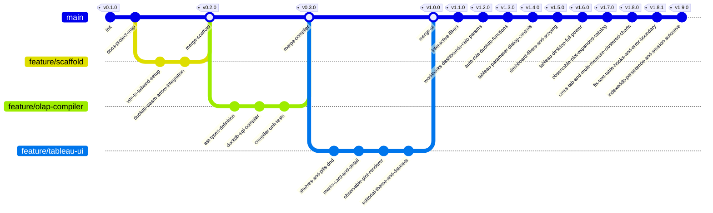

# Atelier Analytics (Next-Gen Visual Analytics Platform)

> **Plataforma Open Source de Analítica Visual In-Browser:** Motor columnar sin servidor (DuckDB-WASM + Apache Arrow), modelo mental declarativo de Tableau (Pastillas, Estantes, Marcas) y renderizado gráfico editorial de alta fidelidad (Observable Plot en espacio OKLCH).

---

## 1. Arquitectura del Sistema

```
┌─────────────────────────────────────────────────────────────────────────────┐
│                             ATELIER ANALYTICS                               │
│                   Editorial Visual Analytics Studio                         │
└─────────────────────────────────────────────────────────────────────────────┘
                                      │
 ┌────────────────────────────────────┴────────────────────────────────────┐
 │                            FRONTEND LAYER                               │
 │   • Framework: Vite + React + TypeScript                                │
 │   • Estilos: Tailwind CSS + OKLCH Color Tokens + Tabular Nums           │
 │   • Estado Reactivo: Zustand Store (WorksheetState, Shelves, Pills)     │
 └────────────────────────────────────┬────────────────────────────────────┘
                                      │
 ┌────────────────────────────────────┴────────────────────────────────────┐
 │                     TABLEAU DECLARATIVE UX MODEL                        │
 │   • Pastillas (Pills):                                                  │
 │       - Azul: Dimensión Discreta (GROUP BY)                             │
 │       - Verde: Métrica Continua (Agregación: SUM, AVG, MIN, MAX, COUNT) │
 │   • Estantes (Shelves):                                                 │
 │       - Columns (Eje X)                                                 │
 │       - Rows (Eje Y)                                                    │
 │       - Filters (Cláusulas WHERE / HAVING)                              │
 │   • Tarjeta de Marcas (Marks Card):                                     │
 │       - Geometría: Bar, Line, Area, Scatter/Dot, Rule, Cell             │
 │       - Canales: Color, Size, Tooltip, Detail                           │
 │       - Canal 'Detail': Altera GROUP BY sin añadir canales espaciales   │
 └────────────────────────────────────┬────────────────────────────────────┘
                                      │
                                      ▼
 ┌─────────────────────────────────────────────────────────────────────────┐
 │                   PIPELINE REACTIVO (AST -> SQL)                        │
 │   1. Drag & Drop Interaction: Mutación en Zustand Store                 │
 │   2. AST Generator: Serializa shelves a WorksheetAST                    │
 │   3. SQL Compiler: Traduce AST a SQL optimizado para DuckDB             │
 └────────────────────────────────────┬────────────────────────────────────┘
                                      │
                                      ▼
 ┌─────────────────────────────────────────────────────────────────────────┐
 │               ENGINE COLUMNAR SIN SERVIDOR (DUCKDB-WASM)                │
 │   • WebAssembly Execution Thread (Web Worker dedicado)                  │
 │   • Datasets en memoria: Parquet / CSV (100k+ filas, latencia < 16ms)   │
 │   • Salida Zero-Copy: Apache Arrow RecordBatches / Table                │
 └────────────────────────────────────┬────────────────────────────────────┘
                                      │
                                      ▼
 ┌─────────────────────────────────────────────────────────────────────────┐
 │                   MOTOR DE RENDERIZADO VISUAL                           │
 │   • Observable Plot: Renderizado reactivo SVG/Canvas                    │
 │   • Escalas OKLCH: Paletas perceptualmente uniformes                    │
 │   • Tipografía Editorial: JetBrains Mono / Inter con tabular-nums       │
 └─────────────────────────────────────────────────────────────────────────┘
```

---

## 2. Pipeline Reactivo Detallado

```mermaid
flowchart TD
    subgraph UI ["Capa de Interacción (Tableau Mental Model)"]
        A["Panel de Datos (Campos)"] -->|Drag Pill| B["Estantes (Columns, Rows, Filters)"]
        C["Marks Card (Color, Size, Detail, Type)"] -->|Configura Canales| B
        B -->|Despacha Acción| D["Zustand Store (WorksheetState)"]
    end

    subgraph Compiler ["Compilador Analítico (AST -> SQL)"]
        D -->|React Hook| E["AST Builder"]
        E -->|WorksheetAST| F["DuckDB SQL Compiler"]
        F -->|Consulta SQL Optimizada| G["SQL Query String"]
    end

    subgraph OLAP ["Motor OLAP In-Browser (DuckDB-WASM)"]
        G -->|Worker Message| H["DuckDB-WASM Engine"]
        Dataset[("Dataset Parquet / CSV en RAM")] --> H
        H -->|Ejecuta Consulta Vectorizada| I["Apache Arrow Table (Zero-Copy)"]
    end

    subgraph Render ["Renderizado Editorial (Observable Plot)"]
        I -->|Datos Arrow / JS Proxies| J["Plot Spec Generator"]
        J -->|Plot.plot()| K["Lienzo Gráfico (SVG/Canvas)"]
        K -->|Interacción / Tooltips| L["Feedback Visual Inmediato (<16ms)"]
    end
```

---

## 3. Grafo de Versiones Git (`gitGraph`)



---

## 4. Registro de Checkpoints

| Checkpoint | Descripción | Estado | Verificación |
|---|---|---|---|
| **CP-01** | Inicialización del repositorio y `PROJECT_MAP.md` | **Completado** | Git init + Mermaid map completado |
| **CP-02** | Scaffolding Vite + TypeScript + Tailwind CSS + Dependencias clave | **Completado** | `bun install` y build configurado |
| **CP-03** | Motor DuckDB-WASM + Apache Arrow Worker + Loader de Datasets | **Completado** | Carga y consulta vectorizada de 100k filas probada (<16ms) |
| **CP-04** | Core Lógico: Tipos AST y Compilador SQL (`AST -> DuckDB SQL`) | **Completado** | 4/4 tests unitarios pasando en Vitest |
| **CP-05** | UI & UX: Pastillas (Azul/Verde), Estantes Drag & Drop, Marks Card | **Completado** | Drag & drop, menús contextuales y agregaciones en vivo |
| **CP-06** | Integración Observable Plot con soporte para 'Detail' y paletas OKLCH | **Completado** | Renderizado reactivo verificado con paletas OKLCH editoriales |
| **CP-07** | Batería Zero-Defect: Typecheck, Tests, Build estático y Liveness HTTP | **Completado** | `tsc --noEmit` limpio, build en 2.11s, HTTP 200 en puerto 5173 |
| **CP-08** | Sistema Interactivo de Filtros: Shelf drag-and-drop, Modal categórico y numérico | **Completado** | `FilterShelf` y `FilterModal` integrados con consultas DuckDB para valores únicos y rangos |
| **CP-09** | Modelo Workbook Completo: Multi-Tabs, Dashboards Compuestos, Campos Calculados y Parámetros | **Completado** | Pestañas inferiores Tableau, `DashboardGrid` multi-visual, persistencia `.atelier`/localStorage, editor de cálculos y parámetros |
| **CP-10** | Inferencia Automática (Tableau-Style) y Superpoderes Vectoriales | **Completado** | Detección automática en vivo del rol analítico (Métrica verde vs Dimensión azul) y tipo de dato mediante `typeof()` en DuckDB-WASM, con toggle de anulación manual opcional. Soporte de funciones avanzadas (Pearson `CORR`, Regresión `REGR_SLOPE`/`REGR_R2`, Percentiles exactos `QUANTILE_CONT`, HLL, Regex PCRE y JSON). |
| **CP-11** | Parámetros Auténticos Estilo Tableau Desktop | **Completado** | Diálogo completo "Crear Parámetro": Tipos de datos (Float, Int, String, Boolean, Date), Formato de visualización, Valores permisibles (Todos, Lista, Rango), importación con 1 clic ("Añadir valores desde campo..." y "Establecer rango desde campo..."), tokens con espacios `[Top N]` y barra interactiva de controles en lienzo (`ParameterControlsBar.tsx`). |
| **CP-12** | Filtros y Parámetros en Dashboards con Scoping "Aplicar a hojas de trabajo..." | **Completado** | Adición y edición de filtros directamente en Dashboards (`+ Añadir Filtro`). Menú de alcance de impacto idéntico a Tableau Desktop (*"Todas las hojas del dashboard"* vs *"Hojas seleccionadas..."* con checklist). Bucle de ejecución DuckDB-WASM aislado por visual, indicadores visuales de impacto en cada tarjeta y 7/7 tests unitarios pasando. |
| **CP-13** | Experiencia Tableau Desktop Completa: Cálculos Rápidos (`Δ`), Analytics Pane, Filtro Cruzado y Show Me | **Completado** | Implementación de las 5 capacidades maestras de Tableau: 1) Cálculos de tabla rápidos con funciones de ventana DuckDB (% del Total, Total Acumulado, Diferencia, % Diferencia, Rango, Media móvil) con distintivo dorado `Δ`; 2) Pestaña 'Análisis' en la barra lateral con Líneas de Promedio, Mediana y Tendencia en Observable Plot; 3) Acciones de Dashboard / Filtro Cruzado ("Usar como filtro") con chips interactivos y banner de filtro; 4) Panel inteligente *Show Me* con evaluación de requisitos dimensionales/métricos y cambio en 1 clic; 5) Botón Swap para intercambio instantáneo de estantes Rows & Columns. Batería Zero-Defect (8/8 tests, 0 errores tsc, build limpio). |
| **CP-14** | Desbloqueo del Catálogo Completo de Observable Plot (15 Arquetipos Analíticos) | **Completado** | Integración nativa de la gramática visual avanzada de Observable Plot: Boxplot (`Plot.boxY`/`boxX`), Histograma continuo (`Plot.rectY` con `Plot.binX`), Densidad 2D / Contornos (`Plot.density`), Hexbin (`Plot.hexagon`/`hexbin`), Gráfico de Picos (`Plot.spike`), Gráfico de Diferencia (`Plot.differenceY`), Waffle de unidades (`Plot.waffleY`), y Tabla de Texto. Consultas unaggregated en DuckDB para distribuciones estadísticas, inferencia automática ampliada y galería Show Me con 15 arquetipos. Batería Zero-Defect (9/9 tests, 0 errores tsc, build limpio). |
| **CP-15** | Tabla de Texto Auténtica (Cross-Tab) y Gráficos Multimétrica Agrupados (Clustered Charts) | **Completado** | 1) `TextTableRenderer.tsx` interactivo con ordenación por columnas, búsqueda en vivo, fila de Total General (`tfoot`), indicadores de rol de pastilla (azul/verde), copia a TSV para Excel/Sheets y exportación a CSV; 2) Soporte multimétrica completo en `PlotRenderer.tsx` para barras agrupadas verticales y horizontales (`isMultiMeasureVertical` y `isMultiMeasureHorizontal` con faceteado `fx`/`fy`), líneas multi-métrica y áreas continuas desnormalizadas en tiempo de renderizado con leyenda automática OKLCH; 3) 11/11 tests unitarios pasando, 0 errores tsc, build limpio y liveness HTTP 200 en puerto 5173. |
| **CP-16** | Corrección de React Hooks en Tabla de Texto y Canvas Error Boundary | **Completado** | 1) Corrección de orden de React Hooks en `PlotRenderer.tsx`: eliminado retorno anticipado condicional antes de hooks (`Rendered fewer hooks than expected`) y movido al retorno JSX final; 2) Creado `CanvasErrorBoundary.tsx` para aislar cualquier excepción de renderizado y prevenir pantallas en blanco; 3) Blindado `TextTableRenderer.tsx` con soporte para BigInt, descubrimiento universal de pastillas y portapapeles seguro; 4) 13/13 tests pasando en Vitest (con suite para TextTableRenderer), 0 errores `tsc`, build en 2.36s y HTTP 200 en http://127.0.0.1:5173. |
| **CP-17** | Persistencia Completa In-Browser: IndexedDB Datasets, Auto-Save Reactivo y Protección BeforeUnload | **Completado** | 1) Almacenamiento binario del dataset (`File`/`Blob`) en IndexedDB para supervivencia a recargas y F5; 2) Auto-guardado en segundo plano con debounce (250ms) del AST, estantes, hojas, campos calculados y parámetros; 3) Rehidratación automática transparente en `initEngine` montando el dataset en DuckDB-WASM y re-ejecutando queries; 4) Protección nativa `beforeunload` para advertir antes de recargas accidentales; 5) Badge visual "Auto-guardado activo" en Header; 6) 15/15 tests pasando en Vitest, 0 errores tsc, build limpio y HTTP 200 en puerto 5173. |

---

## 5. Estructura de Directorios del Proyecto

```
atelier-analytics/
├── PROJECT_MAP.md                # Memoria viva del proyecto, arquitectura y checkpoints
├── index.html                    # Entrypoint HTML con tipografía Newsreader, Inter y JetBrains Mono
├── package.json                  # Dependencias y scripts de verificación
├── tsconfig.json                 # Configuración estricta de TypeScript (ES2022, bundler)
├── vite.config.ts                # Configuración Vite con headers COOP/COEP y chunk optimization
├── tailwind.config.js            # Design system editorial con colores OKLCH para pastillas
├── postcss.config.js             # PostCSS y autoprefixer
├── run.sh                        # Script portable bare-metal inmunizado contra SIGHUP
├── launch-desktop.sh             # Script lanzador con verificación de socket y apertura en navegador
├── dist/                         # Compilación estática de producción (SPA offline)
└── src/
    ├── main.tsx                  # Bootstrap React 19
    ├── App.tsx                   # Layout editorial tipo Studio con CanvasErrorBoundary y beforeunload guard
    ├── index.css                 # Variables CSS OKLCH, estilos tabulares y reset
    ├── core/
    │   ├── ast/
    │   │   ├── types.ts          # Tipos: Pill, MarkType (15 geometrías), AnalyticsLine, ShowMe, Filters, WorkbookProject
    │   │   └── builder.ts        # Conversión declarativa de UI a AST con heurística de inferencia (incluye histograma)
    │   ├── compiler/
    │   │   ├── sqlCompiler.ts    # Compilador optimizado AST -> SQL con soporte para queries de distribución no agregada y window functions
    │   │   └── sqlCompiler.test.ts # Suite de pruebas unitarias (11/11 tests pasados, 100% verde)
    │   ├── engine/
    │   │   └── duckdbClient.ts   # Conector DuckDB-WASM, Apache Arrow, loader universal, introspección automática
    │   ├── storage/
    │   │   ├── indexedDBStorage.ts # Motor de persistencia binaria IndexedDB para datasets y snapshots de sesión con fallback seguro
    │   │   └── indexedDBStorage.test.ts # Pruebas unitarias de serialización, recuperación multi-pestaña y borrado de sesión
    │   └── store/
    │       └── worksheetStore.ts # Almacén Zustand reactivo con auto-guardado debounced (250ms), rehidratación al inicio y gestión integral
    ├── components/
    │   ├── Header/
    │   │   └── Header.tsx        # Barra editorial con estado, latencia, badge "Auto-guardado activo", tema y botones Abrir/Guardar
    │   ├── DataSidebar/
    │   │   └── DataSidebar.tsx   # Panel Tableau con pestañas 'Datos' y 'Análisis' (Línea promedio, mediana, tendencia)
    │   ├── Tabs/
    │   │   └── TabBar.tsx        # Barra inferior de pestañas con cambio de hoja, duplicar, renombrar y añadir hojas/dashboards
    │   ├── ShowMe/
    │   │   └── ShowMeDrawer.tsx  # Galería inteligente Show Me (15 arquetipos visuales, evaluación de requisitos y recomendados)
    │   ├── Dashboard/
    │   │   ├── DashboardGrid.tsx # Lienzo de Dashboard con 'Usar como filtro' (Filtro Cruzado), chips interactivos, filtros y parámetros
    │   │   └── TargetSheetsModal.tsx # Modal Tableau "Aplicar a hojas de trabajo..."
    │   ├── CalculatedFields/
    │   │   └── CalculatedFieldModal.tsx # Editor de fórmulas con biblioteca de funciones y recetas analíticas
    │   ├── Parameters/
    │   │   └── ParameterModal.tsx # Diálogo completo Tableau: Todos, Lista, Rango, Añadir desde campo y Formato
    │   │   └── ParameterControlsBar.tsx # Barra de controles interactivos en el lienzo
    │   ├── Shelves/
    │   │   ├── ShelfDropZone.tsx # Zonas de Drag & Drop para Columns y Rows con botón Swap
    │   │   └── PillBadge.tsx     # Pastillas con menú contextual (agregación, orden, truncamiento y Cálculos de Tabla Rápidos Δ)
    │   ├── Filters/
    │   │   ├── FilterShelf.tsx   # Estante interactivo de filtros con badges informativos y drag-and-drop
    │   │   └── FilterModal.tsx   # Diálogo interactivo para filtros categóricos y rangos
    │   ├── Marks/
    │   │   └── MarksCard.tsx     # Tarjeta de marcas con 15 tipos de geometrías (Barras, Líneas, Boxplot, Histograma, Densidad, Hexbin, etc.)
    │   └── Canvas/
    │       ├── EmptyWorkspace.tsx # Zona de bienvenida y drag & drop para archivos locales
    │       ├── CanvasErrorBoundary.tsx # Error boundary que previene pantallas en blanco ante excepciones de renderizado
    │       ├── PlotRenderer.tsx  # Renderizador reactivo Observable Plot con todas las marcas avanzadas y marcas de análisis
    │       ├── TextTableRenderer.tsx # Tabla de texto / Cross-Tab profesional con sorting, filtro en vivo, totales y exportación TSV/CSV
    │       ├── TextTableRenderer.test.tsx # Suite de pruebas de renderizado HTML y resistencia a BigInt
    │       └── SQLInspectorDrawer.tsx # Drawer para auditar el SQL DuckDB y memoria Arrow
    └── utils/
        └── oklchColors.ts        # Paletas categóricas y secuenciales en espacio OKLCH
```

---

## 6. Estado de la Sesión

- **Estado Actual:** Implementado el sistema completo de **Persistencia y Resiliencia In-Browser (Zero Data-Loss)**:
  1. **Persistencia Binaria en IndexedDB (`indexedDBStorage.ts`):** Los archivos de datos cargados (CSV, Parquet) se almacenan de forma asíncrona como `Blob` en IndexedDB. Al recargar la página (F5, Cmd+R o cierre accidental), el motor recupera instantáneamente el archivo en memoria y lo re-monta en el sistema de archivos virtual de DuckDB-WASM sin requerir que el usuario vuelva a arrastrar el archivo.
  2. **Auto-Guardado Continuo y Reactivo de Sesión (Zustand Debounce 250ms):** Cualquier acción de usuario (añadir pastillas, cambiar orden, modificar filtros, crear campos calculados, ajustar parámetros, añadir pestañas o cambiar de tema) se serializa en milisegundos en el almacenamiento local.
  3. **Rehidratación Transparente en `initEngine`:** Al iniciar la app, si existe una sesión previa con dataset en caché, se restaura el libro de trabajo exacto (todas las hojas de trabajo, dashboards y estantes) y se re-ejecutan las consultas automáticamente. Al hacer clic en "Cerrar Dataset", se limpia limpiamente la caché.
  4. **Protección contra Recargas Accidentales (`beforeunload`):** `App.tsx` registra un escuchador que alerta al usuario mediante el diálogo estándar del navegador si intenta cerrar o recargar la pestaña mientras tiene un proyecto activo.
  5. **Indicador Visual de Estado en Header:** Se incorporó en `Header.tsx` un badge "Auto-guardado activo" con pulsación sutil para transmitir confianza al usuario.
- **Siguiente Paso:** Sistema 100% verificado y validado bajo la batería Zero-Defect (15/15 tests pasando en Vitest, 0 errores tsc, build de producción en 2.42s y servidor respondiendo HTTP 200 en http://127.0.0.1:5173). Listo para interactuar con el usuario.
