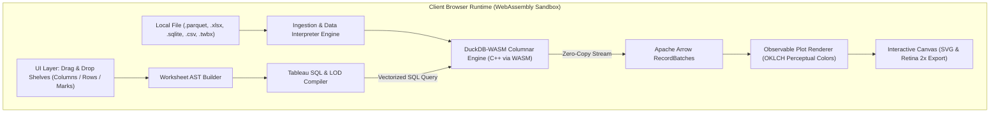

# Atelier Analytics 📊

> **Next-Gen In-Browser Visual Analytics Studio:** A private, serverless analytical workspace combining Tableau's declarative grammar (Pills, Shelves, Marks Card) with a columnar engine in WebAssembly (**DuckDB-WASM** + **Apache Arrow**) and editorial data graphics (**Observable Plot** in OKLCH color space).

[](https://github.com/atelier-analytics/atelier-analytics)
[](LICENSE)
[](https://www.typescriptlang.org/)
[](https://react.dev/)
[](https://duckdb.org/)
[](https://observablehq.com/plot)
[](#-privacy--zero-data-egress)

---

## ✨ Why Atelier Analytics?

Traditional desktop BI software (like Tableau Desktop or Power BI) is heavy, requires expensive recurring licenses, and continually pushes your data toward cloud servers. Web BI tools often require hosting complex databases, Redis caches, and Docker fleets.

**Atelier Analytics eliminates that complexity:**
* **Zero Server / Zero Cloud**: Runs 100% inside your browser using WebAssembly. Your data never leaves your machine.
* **Instant Start (<100ms)**: Lightweight bundle (~471 kB core), opens immediately without waiting for heavy desktop suites to boot.
* **Tableau's Mental Model**: If you know Tableau, you already know Atelier. Drag and drop blue dimension pills, green metric pills, configure marks, write formulas, and build cross-filtering dashboards.
* **Modern Analytic Formats**: Native support for Apache Parquet, Excel (.xlsx/.xls), SQLite, CSV, and even unpacking existing Tableau workbooks (.twbx / .twb).
* **Editorial Aesthetics ("Unslop")**: Designed under Swiss precision principles. No pastel rainbow fluff or AI slop: crisp sub-pixel rim lights, tabular figures (`tabular-nums font-mono`), and perceptual OKLCH color palettes.

---

## 🏛️ System Architecture



---

## 🚀 Key Features

### 1. Tableau Declarative Grammar
* **Discrete vs. Continuous Pills**: Blue pills (Dimensions / `GROUP BY`) and green pills (Measures / Aggregations: `SUM`, `AVG`, `MIN`, `MAX`, `COUNT`, `MEDIAN`, `COUNT_DISTINCT`).
* **Visual Shelves**: Columns (X-axis), Rows (Y-axis), and Filters shelf.
* **Marks Card**: Channels for **Color**, **Size** (proportional bubble scaling), **Detail** (alters level of detail without adding spatial axes), and **Tooltip**.
* **15 Visual Geometries**: Bars (clustered & stacked), Lines, Areas, Dots/Scatter, Heatmap Cells, Boxplots, Histograms, 2D Density, Hexbin, Spikes, Differences, Waffles, and Cartographic Maps (`Plot.geo`).

### 2. Tableau Calculation Engine
* **Level of Detail (LOD) Expressions**: Full support for `{FIXED [Dim] : AGG([Field])}`, `{FIXED : AGG([Field])}` (table-scoped), `{INCLUDE ...}`, and `{EXCLUDE ...}` compiled to correlated vector subqueries.
* **Table Calculations (Window Functions)**: 
  * `RUNNING_SUM`, `RUNNING_AVG`, `RUNNING_COUNT`, `RUNNING_MIN`, `RUNNING_MAX`
  * `WINDOW_AVG`, `WINDOW_SUM`, `WINDOW_MIN`, `WINDOW_MAX`, `WINDOW_COUNT`
  * `RANK`, `RANK_DENSE`, `INDEX`, `FIRST`, `LAST`, `LOOKUP`
* **Tableau Formulas**: Bracketed syntax `[Field]`, `IF..THEN..ELSEIF..ELSE..END`, `IIF`, `ZN`, and `ISNULL`.
* **Formula Assistant**: In-dialog preview of row 1 evaluated by DuckDB, with parameter support and formula recipes.

### 3. Multi-Sheet Dashboards & Mark Cross-Filtering
* Multi-card grid canvas combining multiple worksheets.
* **Click-to-Filter Actions**: Clicking a bar, dot, or cell directly applies a cross-filter across all target sheets.
* **Tableau Visual Focus**: Non-selected marks automatically dim to 30% opacity, while active filtered marks highlight with a gold focus border.

### 4. Advanced Analytics & Statistical Lines
* Reference lines for **Average**, **Median**, **Minimum**, and **Maximum**.
* **Linear Regression Trendline** (`Plot.linearRegressionY`).
* **Moving Average Smoothing** (`Plot.windowY` with configurable window).

### 5. Native Ingestion of Multiple Formats
* **Apache Parquet**: Columnar format read directly with zero-copy Arrow memory mapping.
* **Excel (.xlsx / .xls)**: Multi-sheet selector powered by SheetJS.
* **SQLite (.sqlite / .db)**: In-memory SQL database exploration.
* **Delimited Text (.csv / .tsv)**: Sniffed and ingested with DuckDB's multi-threaded reader.
* **Tableau Workbooks (.twbx / .twb)**: Parses Tableau XML, extracts calculated fields, formulas, column captions, and worksheet shelves.

### 6. Executive Export
* **Retina 2x PNG**: High-resolution image export with adaptive background for executive presentations.
* **Vector SVG**: Pure SVG with XML namespaces for Figma, Illustrator, or LaTeX.
* **PDF & Print Ready**: Custom `@media print` rules removing UI chrome for clean report printing.

---

## 🛠️ Quick Start

### Prerequisites
* [Bun](https://bun.sh) (recommended) or [Node.js](https://nodejs.org) (v20+).

### 1. Clone the repository
```bash
git clone https://github.com/atelier-analytics/atelier-analytics.git
cd atelier-analytics
```

### 2. Install dependencies
```bash
# Using Bun (fastest)
bun install

# Or using npm
npm install
```

### 3. Start development server
```bash
# Using Bun
bun dev

# Or using npm
npm run dev
```

Open [http://localhost:5173](http://localhost:5173) in your browser.

---

## 💻 Desktop Launchers (One-Click Launch)

Atelier includes one-click convenience runners for all operating systems:

* **macOS**: Double-click [`launch-desktop.sh`](launch-desktop.sh) (or run `./launch-desktop.sh` in Terminal). Automatically launches the background daemon and opens your default browser.
* **Windows**: Double-click [`launch-desktop.bat`](launch-desktop.bat) or run `powershell -ExecutionPolicy Bypass -File launch-desktop.ps1`.
* **Linux**: Run `./run.sh` from any terminal.

---

## 🧪 Verification & Zero-Defect Battery

Atelier maintains a strict zero-defect policy. To verify typing, unit tests, and production build in a single step:

```bash
npm run verify
```

This runs:
1. `tsc --noEmit` (Strict TypeScript verification — 0 errors tolerance).
2. `vitest run` (54/54 automated test suite covering SQL compilation, LODs, Table Calcs, and formatters).
3. `vite build` (Clean production bundle build).

---

## 🔒 Privacy & Zero Data Egress

Your data is yours. Atelier Analytics has:
* **No analytics tracking or telemetry.**
* **No remote database synchronization.**
* **No server-side uploads.**

When you drop a 1 GB `.parquet` file into Atelier, the file is read locally by DuckDB-WASM inside your machine's browser memory. You can run Atelier completely disconnected from the internet.

---

## 🤝 Contributing

Contributions are very welcome! Please read [CONTRIBUTING.md](CONTRIBUTING.md) for details on code style, testing requirements, and the pull request process.

---

## 📄 License

This project is licensed under the **MIT License** — see the [LICENSE](LICENSE) file for details.
